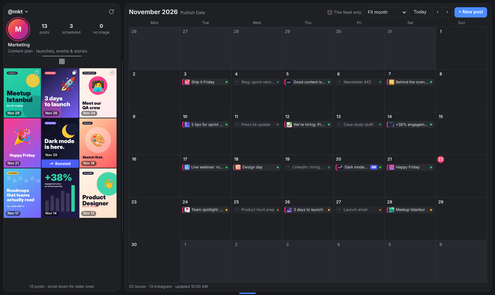
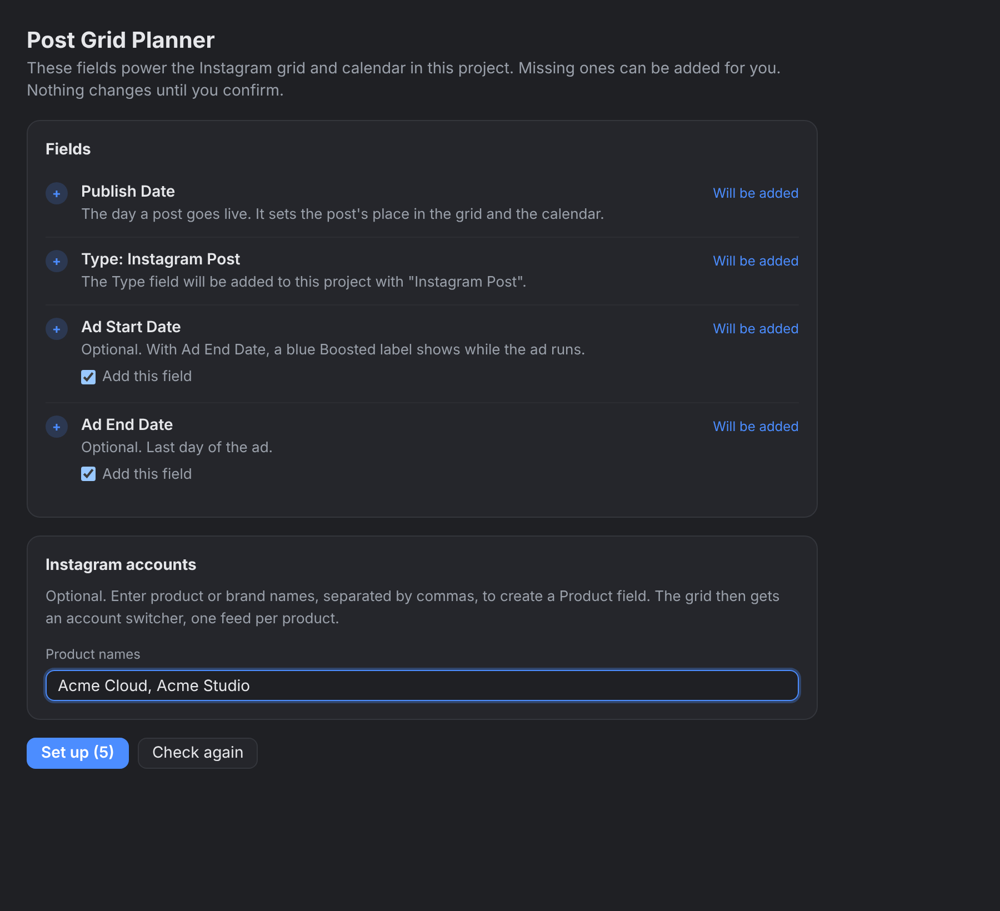

# Post Grid Planner for YouTrack

Plan Instagram posts in YouTrack and see your feed before anything goes live.

Post Grid Planner adds a tab to your YouTrack project with a content calendar on the right and an Instagram-style
profile grid on the left. Every post is a regular YouTrack issue, so the plan, the visuals and the status live in the
same place your team already works.



## Features

- **Calendar and grid side by side.** Schedule posts on a monthly calendar; the grid orders them like a real profile,
  newest on top and older posts further down. With more than 9 posts the grid scrolls.
- **Images from the issue.** Attach an image to an issue and it appears in the grid. Posts without an image show as an
  empty tile you can click to add one.
- **Carousels and cover images.** Several images make a carousel. Pick the cover by putting `cover` in the file name or
  in the comment you attach the image to.
- **Drag to reschedule.** Move a post to another day in the calendar and the grid reorders itself.
- **Several Instagram accounts.** If the project has a Product, Department or Brand field, switch between one feed per
  account, just like the account switcher in Instagram.
- **Boosted posts.** Posts whose ad is running (between Ad Start Date and Ad End Date) get a blue **Boosted** bar.
- **One-click setup.** A Project Settings tab adds the fields the planner needs, after you confirm.
- Light and dark themes. Plain HTML, CSS and JavaScript, no external services.

## Requirements

- YouTrack 2026.2 or later (Cloud or Server).
- Permission to read issues in the project. Creating posts needs permission to create and update issues.
- Running the setup needs project admin rights. Creating brand-new custom fields may need a YouTrack administrator.

## Installation

1. Get `post-grid-planner.zip`: download it from [Releases](../../releases) when one is published, or build it yourself
   (see [Development](#development)).
2. In YouTrack, go to **Administration → Apps → Add app → Upload ZIP file** and choose the file.
3. Attach the app to your project: open the app in **Administration → Apps**, then **Projects → Manage projects**.

Uploading a newer ZIP replaces the installed version and keeps the project attachment and your data.

## Setup

Open **Projects → *your project* → Settings → Post Grid Planner**. The page checks the project and marks each field as
**Ready** or **Will be added**. Click **Set up**, review the list of changes and click **Apply**.



| Field | Type | Used for | Required |
| --- | --- | --- | --- |
| **Publish Date** | date | The day a post goes live. Sets its place in the grid and the calendar. | Yes |
| **Type** = `Instagram Post` | value in the Type field | Marks which issues are Instagram posts. Only these appear in the grid. | Yes |
| **Ad Start Date** | date | First day of a paid promotion. | No |
| **Ad End Date** | date | Last day of a paid promotion. | No |
| **Product** (or Department, Brand) | single or multi value | One Instagram account per value; enables the account switcher. | No |

Notes:

- If the project already has a field named Product, Department, Brand or Account (for example `Product | Department`),
  the setup page uses it and can add new values to it. Otherwise it can create a `Product` field for you.
- Values are added to the field's value set. If other projects share the same set (for example the default "Types"
  set), they will see the new value too. Existing issues are not changed. The confirmation dialog says which sets are
  affected.
- Prefer to set things up by hand? Add the fields in **Project Settings → Fields** with the names above; the planner
  finds them by name. Without Publish Date it falls back to `Post Date` and then `Due Date`.

## Using the planner

Open **Projects → *your project* → Post Grid Planner**.

### Create a post

Click **+ New post**, or the **+** on a day in the calendar (double-clicking a day works too). Enter a title, date,
optional caption and an image (drop, paste or browse). The issue is created with Type = Instagram Post and the account
that is selected in the grid.

### Images, carousels and the cover

- The first image attached to the issue is the cover by default.
- To choose another cover, use an image whose **file name contains `cover`** (the **Use as cover image** checkbox in the
  dialog adds `cover_` to the name), or attach the image in **Add comment** and write **`cover`** in the same comment.
- If several images are marked, the most recently added one wins.
- Click a tile to see the post's details, including which image is the cover.

### Reschedule

Drag a post to another day in the calendar. Days with more posts than fit show **+N more**; click it for the full list.

### Instagram accounts

Click the **@handle** above the grid to switch accounts. **All accounts** shows every Instagram post, **No Product**
shows posts without a value. In the calendar, posts from other accounts are dimmed; tick **This feed only** to hide them.

### Boosted posts

When today is between a post's **Ad Start Date** and **Ad End Date**, its tile shows a blue **Boosted** bar and the
calendar entry gets an **Ad** label. If only one of the two dates is set, the range is open-ended on the other side.

### Layout

- **Fit month** keeps the whole month visible; **Rows: small / medium / large** uses fixed row heights.
- Drag the line between the grid and the calendar to change the grid width (double-click to reset).
- Drag the handle at the bottom edge to change the height (double-click for automatic).
- Layout preferences are remembered.

## Troubleshooting

| What you see | What to do |
| --- | --- |
| "Finish setup" hint and no posts | The project is missing Publish Date or the Instagram Post value. A project admin runs **Settings → Post Grid Planner → Set up**. |
| No Settings menu in the project | You aren't a project admin. Ask your admin to run the setup once; it applies to everyone. |
| The account switcher is missing | The project has no Product, Department or Brand field. Add product names on the setup page. |
| An image doesn't upload from the dialog | The issue is still created. Drag the image onto the issue in YouTrack; the grid updates within a minute or after **Refresh**. |
| The tab looks outdated after an update | Reload the page with **Ctrl+F5** (Cmd+Shift+R on macOS). |

## Privacy and permissions

- The app only calls the YouTrack REST API, as the signed-in user. No data is sent outside YouTrack.
- The project tab is shown to users who can read issues. Every change goes through YouTrack's own permission checks.
- Layout preferences are stored with YouTrack's app storage.

## Development

```
manifest.json            app manifest
icon.png                 app icon
widgets/planner/         project tab (calendar + grid)
widgets/setup/           Project Settings tab (field setup)
build.py                 builds the release ZIP
docs/images/             screenshots for this README
```

There are no dependencies or build tools. To work on the UI outside YouTrack, serve the folder and open a widget in the
browser; it runs with sample data:

```sh
python3 -m http.server 8000
# http://localhost:8000/widgets/planner/index.html
# http://localhost:8000/widgets/setup/index.html          (project with fields)
# http://localhost:8000/widgets/setup/index.html?empty    (empty project)
```

Build the ZIP you upload to YouTrack. The script removes the sample-data code (between `@preview-start` and
`@preview-end`) from the release files:

```sh
python3 build.py    # creates dist/ and post-grid-planner.zip
```

Field names the planner looks for are constants at the top of `widgets/planner/app.js` and `widgets/setup/setup.js`.

## License

[Apache License 2.0](LICENSE)
